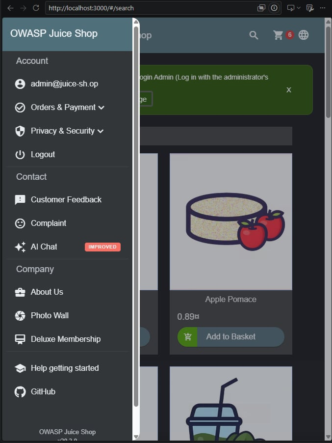
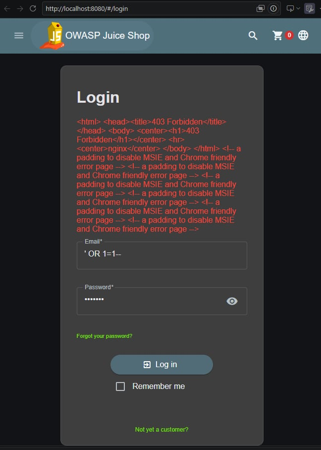
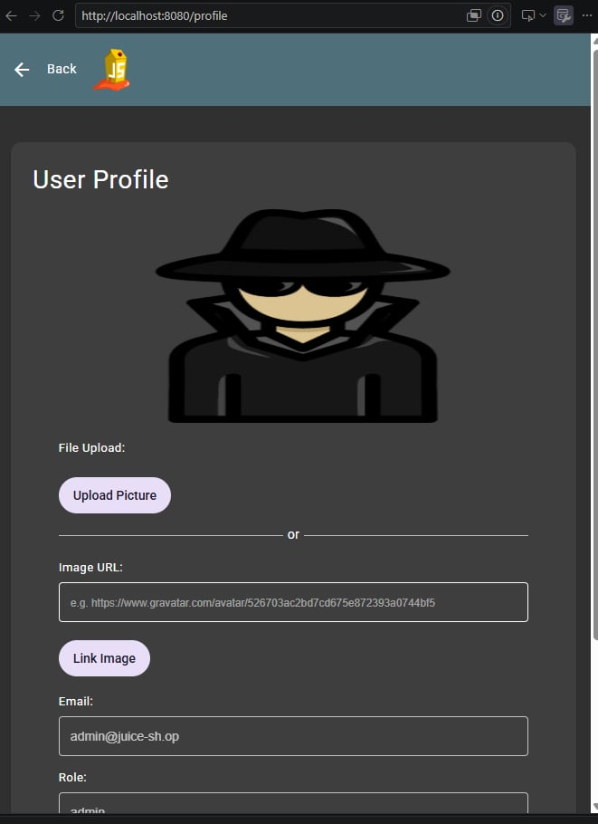
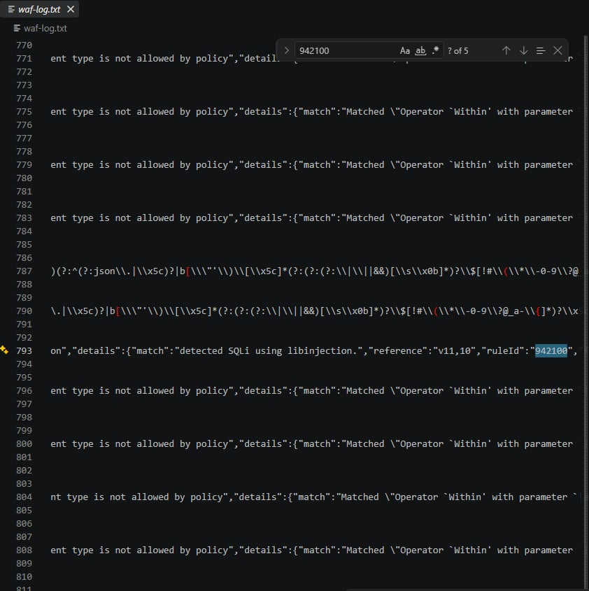

# Thực hành WAF trên Nginx

Bài thực hành môn **Thiết kế cho bảo mật**.

- **Họ và tên:** Nguyễn Minh Khuê
- **MSSV:** 24021536
- **Lớp:** 2627I_INT3105_3

## 1. Mục tiêu

Triển khai **Nginx + ModSecurity + OWASP CRS** trước ứng dụng OWASP Juice Shop để kiểm tra khả năng chặn SQL injection.

```text
Không qua WAF: Client → localhost:3000 → Juice Shop
Qua WAF:      Client → localhost:8080 → Nginx + ModSecurity + CRS → Juice Shop
```

Nginx chuyển tiếp request, ModSecurity kiểm tra request và OWASP CRS cung cấp các luật phát hiện tấn công. Cổng 3000 được mở để so sánh với trường hợp có WAF.

## 2. Cách chạy

Mở Docker Desktop ở chế độ Linux containers. Tại thư mục chứa [docker-compose.yml](docker-compose.yml), chạy:

```sh
docker compose up -d
docker compose ps
```

Đợi ứng dụng khởi động xong rồi truy cập:

- Không qua WAF: http://localhost:3000
- Qua WAF: http://localhost:8080

Các cấu hình chính:

| Cấu hình | Ý nghĩa |
|---|---|
| `BACKEND: http://web:3000` | Chuyển request tới Juice Shop trong mạng Docker. |
| `MODSEC_RULE_ENGINE: "On"` | Bật chế độ chặn request vi phạm. |
| `BLOCKING_PARANOIA: "1"` | Sử dụng mức paranoia 1. |

## 3. Thử nghiệm

### 3.1. SQL injection khi không qua WAF

Mở http://localhost:3000/#/login và nhập:

```text
Email: ' OR 1=1--
Password: test123
```

**Kết quả:** đăng nhập được tài khoản `admin@juice-sh.op` dù không sử dụng mật khẩu đúng.



### 3.2. SQL injection khi qua WAF

Đăng xuất, mở http://localhost:8080/#/login và nhập lại cùng email, mật khẩu ở trên.

**Kết quả:** request bị chặn, ứng dụng hiển thị phản hồi **403 Forbidden** từ Nginx.



### 3.3. Đăng nhập hợp lệ qua WAF

Tại http://localhost:8080/#/login, đăng nhập bằng tài khoản mẫu:

```text
Email: admin@juice-sh.op
Password: admin123
```

**Kết quả:** đăng nhập thành công và truy cập được trang hồ sơ của tài khoản admin qua cổng 8080.



## 4. Kiểm tra log

Chạy lệnh:

```sh
docker compose logs waf
```

Log thực tế của request `POST /rest/user/login` bị chặn có các rule:

- **942100:** phát hiện SQL injection bằng libinjection.
- **949110:** tổng điểm bất thường đạt ngưỡng chặn; request trả HTTP 403.

Ảnh dưới đây cho thấy rule `942100` trong log:



## 5. Kết luận

| Trường hợp | Kết quả |
|---|---|
| SQL injection không qua WAF | Đăng nhập được admin. |
| SQL injection qua WAF | Bị chặn với HTTP 403. |
| Đăng nhập hợp lệ qua WAF | Đăng nhập thành công. |

WAF thể hiện mẫu **Gatekeeper**, kiểm tra request trước khi vào ứng dụng, và **Gateway Offloading**, đảm nhận việc kiểm tra bảo mật tại proxy.

WAF chặn được payload đã thử nhưng không sửa lỗ hổng SQL injection của ứng dụng. Khi triển khai thực tế, cần sửa lỗi ứng dụng và ngăn client truy cập trực tiếp backend để bỏ qua WAF.

Kết thúc thực hành:

```sh
docker compose down
```
